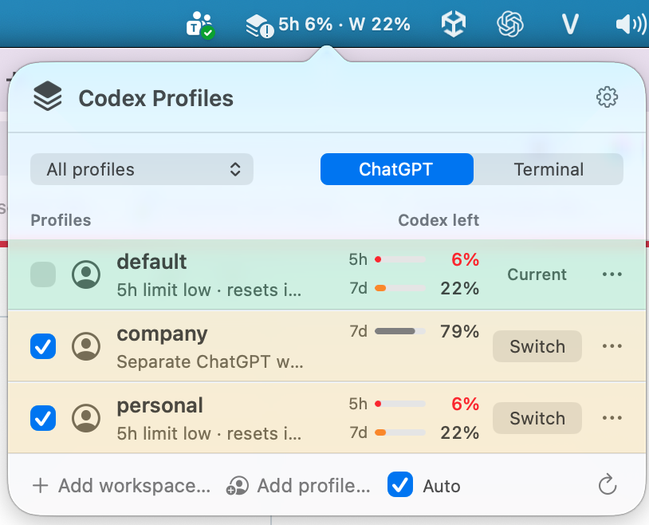
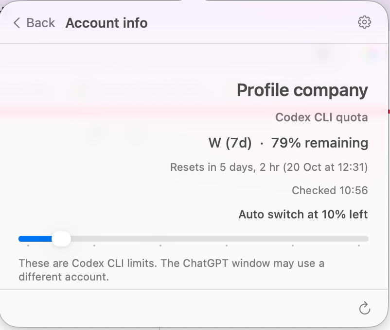

# Codex Profiles for macOS

The native menu-bar companion bundles the existing `codex-profile` engine.
It runs on macOS 13 or newer, on Apple silicon and Intel. It requires neither
Swift nor a separate `codex-profile` installation on the user's Mac.

Drag **AI Profile.app** to **Applications**, open it, and choose
**Open** beside an existing profile. If none exists, choose **Create profile…**
and enter a name such as `work` or `personal`. A project folder is not required.
You may optionally choose an existing `auth.json` in the creation dialog. The
app creates the normal separate named profile, copies that file into it with
private permissions, and refreshes Codex quota. Without a selected file, it
creates the profile as before. The file must be named `auth.json`; existing
profiles are never overwritten by this action.
The app opens its menu when you launch it. **New profile…** is also in its gear
menu. **Add profile…** sits beside **Add workspace…** in the footer. **Add workspace…** optionally binds a project folder to a profile for a
shortcut. **Open at Login** in the gear menu starts the app quietly in the menu
bar when you log in; macOS may ask you to allow it in Login Items. Opening the
app again from Finder or Spotlight shows the menu.

Open a profile or workspace in **ChatGPT** to use the original installed ChatGPT app. When both ChatGPT.app and Codex.app are installed, the menu uses the one that is running (so **Switch** quits and reopens that bundle); an explicit `CHATGPT_APP`, `CODEX_APP` or `CODEX_APP_BIN` always wins, and with none running the first installed app is used.
A named profile opens a window with separate local Desktop state and may
require sign-in inside that window. `default` uses the stock Desktop session.
**Sign In to Codex CLI** in the settings menu starts the official CLI login in
Terminal; it applies only to Codex. Account info reads the local access token
JWT expiry claim when available, without printing or uploading credentials.
An access token may refresh automatically; its expiry is not the expiry of the
profile or account. The app does not verify that Desktop and CLI use the same account.
The create-profile and update pickers and named profile **Switch** buttons are explicit
credential-copy actions. They copy files without parsing or printing them.

ChatGPT launching requires the official desktop app. Terminal launching and
CLI login require the official Codex CLI, either installed separately or
available from the desktop app. Terminal actions may ask for macOS Automation
permission. CLI discovery supports both legacy and current Desktop bundle
layouts, including Finder launches without a separate CLI on PATH.
Local-state separation does not isolate OS credentials or create
a server-side account boundary.

## Menu and keyboard

The menu uses a profile filter and a ChatGPT/Terminal
destination control. Profiles appear first and can open without a folder from
their actions menus. Clicking a profile row only selects it; named profiles
have a **Switch** button and `default` has no primary action button. Clicking
an avatar opens an Info page for that profile; **Back** returns to the list.
Account info shows the access token expiry from that profile's local `auth.json`,
or **Unavailable** if there is no readable JWT expiry claim.
Pinned projects follow; other projects follow their last successful launch.
Workspace rows show the project name, profile and folder,
with an explicit **Open** button and an actions menu. Missing folders and
profiles show the reason and retain actions for repair or removal. Refresh
failures preserve loaded content while retaining committed binding changes.
While a binding change is in progress, its row shows **Updating…** and cannot
open, so it never launches the previous profile.

Every row's actions menu offers **Open in ChatGPT** and **Open in Terminal**,
which use that destination once without changing the default. Profile rows
also offer **Add workspace…** for that profile and **Sign in to Codex CLI…**.
Named profile rows additionally offer **Update auth.json…**, **Rename profile…** and **Remove profile…**.
Updating authentication copies a selected `auth.json` into that profile, keeps the previous file as a
private backup in its profile home, and refreshes Codex CLI usage. An open ChatGPT window may need to be
reopened to use the new authentication. Rename moves the
profile home, workspace bindings, and managed launcher after its window is closed. Their **Switch** button
asks for confirmation, closes all running instances of
the signed Desktop app, saves the previous default `auth.json` as a private
backup in `~/.codex`, copies the selected credential, reopens default only if
Desktop was running, and refreshes usage. Removal asks for confirmation, then permanently deletes the
named profile home and its workspace bindings. `default` cannot be removed
from this menu.
The profile last switched into `default` has no **Switch** button. `default`
has a green row; profiles checked for automatic switching have yellow rows.
The checkbox beside **Add profile…** enables automatic switching, and each
profile's checkbox controls whether it participates. The avatar's Info panel
has a per-profile slider for the remaining-quota threshold (10% by default).
When the active profile reaches its threshold, the app chooses the checked
named profile with the most quota remaining above its own threshold. It uses
fresh Codex CLI readings and leaves Desktop closed if it was closed. A new
quota event written to the current profile's local session log triggers an
immediate check and switch when eligible; the five-minute quota check remains
the fallback when sessions produce no event. The monitor reads only appended
rate-limit events and never reads authentication files. The
current profile marker records switches made by this menu; it does not verify
the account inside Desktop or track changes made elsewhere.
Actions that cannot apply, such as revealing a missing folder, are disabled.

↑/↓ selects available profiles or projects; Return opens the selection.
⌘1–9 opens the corresponding visible row, and ⌘R refreshes.
Escape returns from Info or closes the menu. Successful launches close the popover.

Profile-only launches start in the home directory. Adding a project shortcut
is a separate action; creating a profile never opens a folder picker unless
you explicitly started **Add workspace…**.

## Claude profiles

The menu is one scrolling panel: **In use** shows the current Codex and Claude account with usage and a "Show in menu bar" checkbox for each (both, either or neither; Auto Codex stays a separate Codex setting), then **Codex profiles**, then **Claude profiles**. The two profile sections start collapsed; click the chevron in a header to expand one, and the app remembers each choice.

- **Account** profiles run Claude Code with their own `CLAUDE_CONFIG_DIR` under `~/Library/Application Support/AI Profile/claude/accounts`. Choose **Sign in…** to run `claude auth login` for that profile in Terminal. The built-in **Default account** is your normal `~/.claude` login.
- Claude Code renews its short-lived access token only while it runs. When an account's token has expired, the menu renews it with the stored refresh token the way Claude Code does (taking Claude Code's `.oauth_refresh.lock` and `.storage-write.lock`) and stores it back in the same Keychain item or `.credentials.json`, keeping every other field. It contacts Anthropic only after a test write of the unchanged credential succeeds, and it waits rather than renewing while Claude Code holds the lock. Tokens are never displayed or logged.
- **API** profiles hold an endpoint, optional model and an API key. The key is stored only in Keychain; Claude Code reads it through `apiKeyHelper`. No request is sent to test it, and no quota is shown for API profiles.

Click a Claude profile's icon to see its info page (account email, plan and organization, or API endpoint, model and whether a key is saved) and **Back** to return to the list; missing details show Unavailable and API keys are never displayed.

- **Switch** on an API profile writes `ANTHROPIC_BASE_URL`, `ANTHROPIC_MODEL` and `apiKeyHelper` into `~/.claude/settings.json`, keeping every other setting. A private backup is saved in `AI Profile/claude/backups` first, and switching to an account profile restores your previous values. Switching to a non-default account profile restores the default settings and marks it current; it applies to Claude Code started with **Open in Terminal**, because Claude Code reads one account per config folder. **Open in Terminal** on any Claude profile that isn't current switches to it first, so Current always matches the session that opens.
- Changes affect new Claude Code sessions only. Running sessions and the Claude Desktop account are not changed.

## Codex usage beside each profile

The **Codex left** column shows the percentage remaining in each reported
quota window, with a small meter beside it. Window labels come from the
response: for example, `5h` and `7d`, or `15m` when that is the actual
duration. At 25% or less a meter turns orange, and at 10% or less it and its
number turn red; the number always carries the value. A low window also
replaces the row's description with its reset time, such as
`5h limit low · resets in 1h 12m`. Hover a reading for each reset time and
when it was checked. Missing limits show **Unavailable**; expired readings
show a dash until refreshed. Neither state disables profile actions.
The avatar opens a separate Info page with the profile name, each reported
quota percentage, reset time and last check. It shows Codex CLI usage only;
it cannot establish the account signed into the ChatGPT window.

Usage belongs to each profile's **Codex CLI** sign-in. Desktop sign-in can
use a different account; the companion does not compare accounts. Sign in
through the profile's actions menu, then press ⌘R. API-key accounts, older
CLIs without this method, offline connections and profiles without CLI sign-in
may not return ChatGPT-backed Codex quota.

The companion uses the official [Codex app-server protocol](https://learn.chatgpt.com/docs/app-server)
through `codex-profile cli <profile> app-server`. It initializes the server,
reads `account/rateLimits/read`, and stops its own subprocess. It prefers the
Codex bucket from `rateLimitsByLimitId`, falling back to the legacy snapshot.
It does not read credential files or send inference requests. Credential
override variables are removed from this query so they cannot substitute an
inherited account for the profile's sign-in.

Reads happen when the menu opens and about every five minutes while the menu-bar
app runs, so `default`'s `5h` and weekly (`W`) remaining percentages stay visible
beside the icon. The bar shows only the icon until a reading is available.
Readings are cached in
memory for 60 seconds, refreshed after a reported reset or with ⌘R, and
limited to two concurrent readers with a ten-second deadline per reader.
During a refresh the previous reading stays visible, dimmed, and each row
updates in place as its reading arrives, keeping hover and keyboard focus.
The query uses a private temporary directory to avoid unrelated workspace
guard bindings. Timeouts, failures, cancellation and Quit stop owned readers;
usage errors do not interrupt profile launches or open error dialogs.

## Low-quota alerts

Use **Hide profile names** in the gear menu to mask visible names in profile
rows, the profile filter, and menus for screenshots. Choose **Show profile
names** to restore them. The choice persists across launches and does not
change profile data or routing.

The menu-bar icon marks low quota on its own. When an initialized profile's
tightest Codex window is at 25% or less, the icon gains a badge dot; at 10%
or less the badge carries an exclamation mark. The icon stays a monochrome
template image, so its shape, not colour, carries the state. Its tooltip and
VoiceOver label name each profile and window, for example
`work: 5h limit at 8%, resets 14:20`. The badge clears when that window's
reset time passes. Quota in a window only falls until it resets, so a reading
stays an upper bound on what is left: the badge never overstates the remaining
quota, but a profile can run lower than it shows until the next reading. The
icon needs no permission. When names are hidden, its tooltip and VoiceOver
label omit profile names.

**Low-quota alerts** in the gear menu adds macOS notifications. It is off by
default, and macOS asks for notification permission only when you turn it on.
If notifications are not allowed, alerts stay off and the app explains how to
allow them in **System Settings › Notifications**. A permission prompt left
unanswered for two minutes counts as not allowed; allow notifications and
choose the toggle again. If permission is revoked later, or was never granted
to this copy of the app, the menu item shows a mixed state; choose it to turn
alerts off.

A notification announces a crossing into low or critical, not a state that
was already there: the first settled reading after launch, or after turning
alerts on, is the baseline. Readings still refreshing at that moment do not
count. Each profile and window notifies at most once per level per reset
period. A reset period follows the reported reset time, so an early reset
starts a new one, while reset times that differ by seconds do not. A window
without a reported reset time notifies again only after climbing more than
five points above the threshold. The notification names the reset time. When another
profile has at least 50% of the same window left in a reading under 15
minutes old, it also says so, for example `personal has 70% left.` Clicking
the notification opens the menu.

The menu-bar percentages check usage about every five minutes through the
same reader, cache, two-reader limit, deadlines and process cleanup. Alerts
use those readings when enabled. Checks stop when the app quits, and no reader starts
when no profile is initialized. A login launch lists profiles once; profiles
created outside the app join the checks the next time the menu opens.

Automatic switching is off by default and requires selecting participating
profiles. Low-quota alerts remain separate from that setting.

## System appearance and accessibility

The running app inherits macOS appearance, including Auto switching between
light and dark mode. Native controls, symbols, dialogs and the popover use
system colours and materials. Custom row decoration resolves colours again
when appearance or accent colours change.

Reduce Motion disables popover animations and updates when the setting changes.
Increase Contrast and Reduce Transparency use opaque system selection fills;
NSPopover handles its own background material. Keyboard selection includes an
outline and an accessibility selected state. Native controls and labelled
actions support keyboard navigation and VoiceOver.

Automated checks cover light → dark → light changes in the same view,
system-colour/accessibility notifications, opaque selection policies, and
keyboard/accessibility state. Alert checks cover the badge shapes at 1x and
2x, crossing and de-duplication rules across jitter, early resets and missing
reset times, the baseline after turning alerts on, headroom choice, the
default-off preference, denied, undecided and unanswered permission, and
background checks following the toggle, using a fake notification center. Actual VoiceOver announcements, OS preference
switching, popover translucency, notification banners and permission prompts
still require a manual check on macOS. Follow [Apple's Dark Mode guidance](https://developer.apple.com/documentation/appkit/supporting-dark-mode-in-your-interface).

The current menu and Account info page are shown in these macOS screenshots:




The images below are renders of the AppKit view in light and dark appearance,
with sample quota values for layout review.
They use an opaque system backdrop for layout review; live translucency is
provided by NSPopover and depends on macOS appearance and accessibility settings.


See the [design notes](CodexProfilesMenu/DESIGN.md) for Apple guidance and
interaction behaviour. Re-render the previews after changing the view:

```sh
scripts/macos/render-menu-preview.sh macos/CodexProfilesMenu/Previews/menu-light.png
scripts/macos/render-menu-preview.sh macos/CodexProfilesMenu/Previews/menu-dark.png --dark
```

## Build locally

Use a macOS source checkout with the Swift compiler and command-line tools:

```sh
make check
make menu-dmg
```

The builder compiles both architectures, bundles the CLI, license and icon,
and creates a compressed, read-only DMG with an Applications shortcut:

```text
build/macos/AI Profile.app
build/macos/Codex-Profiles-1.3.0-universal.dmg
build/macos/Codex-Profiles-1.3.0-universal.dmg.sha256
```

`make menu-app` builds just the app. `MENU_APP_BUILD_DIR` changes the output
directory. Bundle versions are taken from the bundled CLI. The canonical
`make check` discovers the native and DMG tests automatically; native builds
are skipped on hosts without macOS and Swift.

The default build is unsigned and intended for development. It is not a
public release and will not pass the normal Gatekeeper distribution checks.

## Sign and notarise a release

Install your **Developer ID Application** certificate and private key in
Keychain. List available identities with:

```sh
security find-identity -v -p codesigning
```

Store notarisation credentials interactively in Keychain, following
[Apple's notarisation workflow](https://developer.apple.com/documentation/security/customizing-the-notarization-workflow):

```sh
xcrun notarytool store-credentials codex-profiles
```

Then build the distributable with the exact certificate name:

```sh
MENU_APP_SIGNING_IDENTITY='Developer ID Application: Your Name (TEAMID)' \
MENU_APP_NOTARY_PROFILE=codex-profiles make menu-dmg
```

The script signs the companion with hardened runtime and the Apple Events
entitlement needed for Terminal, signs the DMG, submits it to Apple, requires
an **Accepted** result, staples and validates the ticket, and assesses the
DMG with Gatekeeper. It writes the final DMG and checksum only after those
checks pass, and restores the previous pair if publishing them fails.
Notarisation results are retained beside the output for diagnosis.
No credentials are stored in the repository. The original ChatGPT app is
never modified or signed by this builder.

Follow [Apple's distribution testing guidance](https://developer.apple.com/documentation/xcode/packaging-mac-software-for-distribution)
to test a downloaded release on a fresh Mac, including opening from the image
and after moving to Applications. Publishing the resulting files is a separate
maintainer step; the build does not upload them to GitHub.

### Publish a signed download

A public download is deferred until the project has a Developer ID. The
signing and notarisation build above is ready; publishing still needs these
maintainer steps:

1. Enrol in the [Apple Developer Program](https://developer.apple.com/programs/)
   and create a **Developer ID Application** certificate. Install it in
   Keychain and store notarisation credentials as described above.
2. Decide how the DMG reaches the release. GitHub Releases here are
   immutable, and the `Release` workflow publishes each release without
   assets, so a DMG cannot be added to a release after it is published. Either
   change the workflow to create a draft, upload the DMG and `.sha256`, then
   publish; or add a macOS job that signs and notarises in CI, passes both
   files to the release job, and attaches them before the release is
   published. A CI job needs the certificate exported as a password-protected
   `.p12` and an App Store Connect API key for `notarytool`, stored as
   `release` environment secrets.
   Either way, a version that already has a published release cannot gain a
   DMG, so the first download ships with a new version.
3. After a release carries the notarised DMG, add a Homebrew cask beside the
   `codex-profile` formula in
   [Ducksss/homebrew-tap](https://github.com/Ducksss/homebrew-tap), pointing at
   the release asset and its SHA-256.
4. Test the downloaded DMG on a Mac that has never built the app, following
   Apple's distribution testing guidance above, before announcing it.
